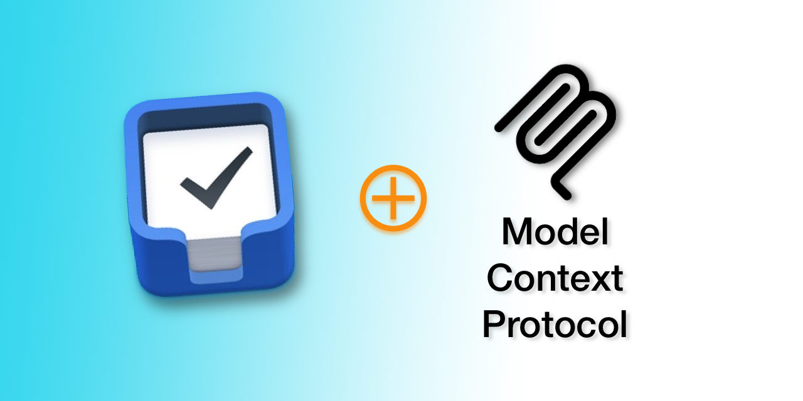
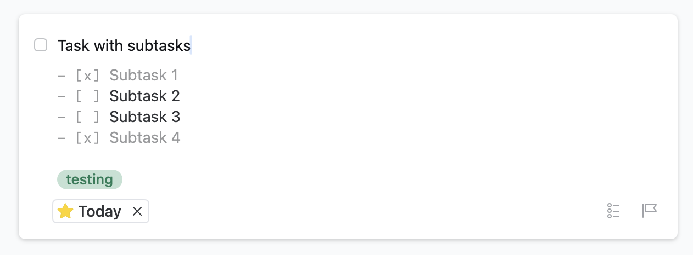

<div align="center">



# Things 3 MCP Server

</div>

This [Model Context Protocol (MCP)](https://modelcontextprotocol.io/introduction) server lets you use Claude Desktop to interact with your task management data in [Things 3](https://culturedcode.com/things). You can ask Claude or your MCP client of choice to create tasks, analyze projects, help manage priorities, and more.

This MCP server uses a combination of the [Things.py](https://github.com/thingsapi/things.py) library and [Things 3’s AppleScript support](https://culturedcode.com/things/support/articles/4562654/), enabling reading and writing to Things 3.

## Why Things MCP?

This MCP server unlocks the power of AI for your task management:

- **Natural Language Task Creation**: Ask Claude to create richly-detailed tasks and descriptions in natural language
- **Smart Task Analysis**: Let Claude explore your project lists and focus areas and provide insights into your work
- **GTD & Productivity Workflows**: Let Claude help you implement productivity and prioritisation systems
- **Seamless Integration**: Works directly with your existing Things 3 data

## Features

- Access to all major Things lists (Inbox, Today, Upcoming, Logbook, Someday, etc.)
- Project and Area management and assignment
- Tagging operations for tasks and projects
- Advanced search capabilities
- Recent items tracking
- Support for nested data (projects within areas, todos within projects)
- Checklist/Subtask support - Read and display existing checklist items from todos

## Things3-MCP 2.5 source candidate

This checkout contains the 2.5.0 source candidate with the signed local bridge and an adaptable ClawBridge reference. It is not a statement that 2.5.0 has been published to PyPI. Use a reviewed source revision for this workflow. The existing 24 MCP tools remain, with three new tools for bridge status and operation inspection.

## Data access and safety

The implementation never writes directly to Things' SQLite database. Creates, updates, completion and movement use Things' AppleScript interface so the app owns its changes and sync. Database readers open SQLite read-only; this is a reader setting, not operating-system confinement of the entire bridge.

Cultured Code recommends its supported automation interfaces and does not support direct database integrations. Raw SQLite reads remain an unsupported live integration even when read-only. The Apple Events fallback returns a limited set of fields and is not equivalent to a full database snapshot. See [Things' integration guidance](https://culturedcode.com/things/support/articles/2967034/) and [its guidance on third-party AI tools](https://culturedcode.com/things/support/articles/5510170/).

## Install the source candidate

You need macOS, Things 3, uv, the pinned Python in `.python-version`, and an MCP client such as Claude Desktop. Building the app also needs Apple's command-line tools.

```sh
git clone https://github.com/rossshannon/Things3-MCP
cd Things3-MCP
# Select the reviewed 2.5 source revision before installing.
uv sync --locked --group build
```

Configure your MCP client with absolute paths. Claude Desktop uses `~/Library/Application Support/Claude/claude_desktop_config.json`:

```json
{
  "mcpServers": {
    "things": {
      "command": "/ABSOLUTE/PATH/TO/uv",
      "args": ["--directory", "/ABSOLUTE/PATH/TO/Things3-MCP", "run", "--locked", "Things3-MCP-server"],
      "env": {
        "THINGS3_MCP_PROVIDER": "auto",
        "THINGS3_MCP_ALLOW_DIRECT_FALLBACK": "0"
      }
    }
  }
}
```

Restart the client after changing its configuration. The [PyPI page](https://pypi.org/project/Things3-MCP-server/) lists published versions; older published versions do not establish the behaviour documented for this candidate.

## Local bridge and access while away

The bridge gives macOS a stable app identity to authorise. The MCP server talks to it over an owner-only Unix socket with a bearer token:

```text
MCP client → Things3-MCP server → local socket + token
  → signed Things3 MCP Bridge.app → bounded worker
    → read-only Things database / Things Apple Events
    → private cache and operation records
```

This aims to support an awake Mac with the user logged in after interactive consent. A locked screen needs separate validation. It does not promise operation during sleep, after logout, before FileVault unlock or through a new consent prompt. A signature check and a responding socket do not prove those conditions.

### Build, sign and install

Read [the build and lifecycle guide](docs/bridge-build.md) for the locked isolated build, signing profiles, retained evidence and rollback procedure. Building does not install, launch or request permissions.

```sh
scripts/build_bridge_app.sh --output build/local-candidate
scripts/sign_bridge_app.sh --app 'build/local-candidate/Things3 MCP Bridge.app' \
  --profile local --identity 'Things3 MCP Local'
codesign --verify --deep --strict 'build/local-candidate/Things3 MCP Bridge.app'
```

Local signing requires an existing Code Signing identity in Keychain; the script never creates or trusts a certificate. An Apple Developer account is not required to use an existing local identity on your own Mac. Ad-hoc test signing does not provide a stable consent identity. Distribution uses the separate Developer ID profile, hardened runtime, notarisation and Gatekeeper validation.

Installation is a separate, deliberate action:

```sh
scripts/install_bridge_launchagent.sh --app 'build/local-candidate/Things3 MCP Bridge.app'
```

The installer stages and verifies the candidate, retains the prior app/plist, and requires authenticated status from the exact installed build and process. Failed readiness triggers rollback. It installs `~/Applications/Things3 MCP Bridge.app` and a per-user LaunchAgent; it never changes macOS privacy grants. The LaunchAgent starts at login and restarts a failed process. Starting the bridge does not itself read the Things database or send Apple Events.

### Choose permissions

Database access and scripting are separate capabilities. A protected SQLite read may need Full Disk Access for the signed bridge. Things AppleScript reads and writes need Automation consent for that bridge to control Things. These are user choices in **System Settings → Privacy & Security**; supported Things scripting needs neither System Events, Accessibility nor Screen Recording.

Full Disk Access is broad, and the default app is unsandboxed. Fixed routes and path validation limit what this service exposes; they are not an operating-system sandbox. An experimental signed App Sandbox profile is documented in [the build guide](docs/bridge-build.md#experimental-app-sandbox-profile). It requires separate frozen-app and real-application acceptance before use. Security-scoped bookmarks do not automatically bypass protected app containers. Read [the security model](docs/security/local-bridge-security.md) before authorising the bridge.

### Verify the intended capability

`get_bridge_status` inspects identity, cache state and the last observed read/write results without requesting consent. App process state is currently reported as unknown; this status call does not inspect the Things process. Unknown or untested permissions stay unknown. A live read and a write must be verified independently.

```sh
uv run --locked python scripts/check_bridge.py
# Explicitly exercise a live snapshot; this can encounter a privacy prompt:
uv run --locked python scripts/check_bridge.py --snapshot
```

Inspect the returned backend. SQLite and the limited Apple Events fallback have different coverage. The default cache is `~/Library/Application Support/Things3-MCP/cache/latest.json`. New LaunchAgents discard stdout/stderr; authenticated status and operation records provide bounded diagnostics. Old log files are not removed.

### Provider modes and 2.5 migration

| Mode | Reads | Writes |
| --- | --- | --- |
| `auto` (default) | Bridge, then last good cache. Direct reads only with the explicit fallback setting. | Bridge only. |
| `bridge` | Bridge required; inspect reported source for any bridge-side cache fallback. | Bridge required. |
| `cache` | Last snapshot only. | Refused. |
| `direct` | Legacy database access from the MCP process. | Legacy AppleScript from the MCP process. |

**Migration:** automatic mode no longer falls back to direct AppleScript writes. Install and authorise the bridge before relying on writes. A user who deliberately needs the legacy path can set `THINGS3_MCP_PROVIDER=direct`, accepting its separate permission identity and weaker timeout boundary. `THINGS3_MCP_ALLOW_DIRECT_FALLBACK=1` affects automatic reads only. Keep it `0` for unattended use.

The MCP bridge call timeout defaults to 35 seconds; the worker deadline defaults to 30 seconds. Client timeout settings must exceed 30 seconds and should stay above the configured worker deadline. A lost response or client timeout still does not establish that a mutation failed. Never retry it automatically. Use its operation ID, or its correlation label if the response was lost, to inspect the result. A later intentional request is a new attempt.

Read output identifies its source. Cached output includes snapshot age and original backend; an Apple Events snapshot retains its limited-coverage warning. Direct bridge callers can send `X-Require-Live: true` when a cached result is unacceptable.

### Operation records

Every dispatched bridge mutation receives an operation ID. `get_bridge_operation(operation_id)` returns its record; `list_bridge_operations(correlation_id=None, limit=25)` lists recent attempts. Outcomes distinguish `not_started`, `succeeded`, `failed` and `outcome_unknown`. An unknown outcome means the app may have changed; inspect the record and app state before deciding whether to try again. Requests are never replayed automatically.

Direct socket clients may attach `X-Correlation-ID`, containing 1–128 ASCII letters, digits or `._:-`. It is a caller label, not authentication or deduplication. The same label can identify several distinct attempts.

The private `operations/` directory beside the socket defaults to metadata only. Its limits are seven days, 1,000 records and 10 MiB; age expiry runs when the journal is accessed, rather than on a background deletion timer. Old inactive records are pruned when needed; active ones are preserved. If storage cannot admit a record, execution does not begin. `THINGS3_MCP_BRIDGE_JOURNAL_PAYLOADS=1` in the bridge process environment explicitly enables request payload retention. This may retain titles and notes; leave it off unless required. To persist this intentional opt-in in a newly installed LaunchAgent:

```sh
THINGS3_MCP_BRIDGE_JOURNAL_PAYLOADS=1 scripts/install_bridge_launchagent.sh \
  --app 'build/local-candidate/Things3 MCP Bridge.app'
```

Set the value to `0` on a later install to disable new payload capture; that does not erase existing records. `.env.example` documents configuration but is not loaded automatically.

### Adapt the bridge

[Adapting ClawBridge](docs/adapting-clawbridge.md) explains the fixed adapter interface, permission choices and verification boundaries. `scripts/export_clawbridge.py` generates a standalone synthetic starter with no Things runtime dependency, pinned tools and revision/hash provenance. The Things checkout remains the core's source of truth.

### Sample Usage with Claude Desktop
* “What’s on my todo list today?”
* “Create a todo to prepare for each of my 1-on-1s next week”
* “Evaluate my todos scheduled for today using the Eisenhower matrix.”
* “Help me conduct a GTD-style weekly review using Things.”

#### Tips
* Create a Project in Claude with custom instructions that explains how you use Things and organize areas, projects, tags, etc. Tell Claude what information you want included when it creates a new task (e.g., asking it to include relevant details in the task description, whether to use emojis, etc.).
* Try combining this with another MCP server that gives Claude access to your calendar. This will let you ask Claude to block time on your calendar for specific tasks, create tasks that relate to upcoming calendar events (e.g., prep for a meeting), etc.


### Available Tools

#### List Views
- `get_inbox` - Get todos from Inbox
- `get_today` - Get todos due today
- `get_upcoming` - Get upcoming todos
- `get_anytime` - Get todos from Anytime list
- `get_someday` - Get todos from Someday list
- `get_logbook` - Get completed todos
- `get_trash` - Get trashed todos, paged by `limit` and `offset` (defaults to 50 items, capped at 200)

#### Random Sampling (for LLM Enrichment)
- `get_random_inbox` - Get a random sample of todos from Inbox
- `get_random_anytime` - Get a random sample of items from Anytime list
- `get_random_todos` - Get a random sample of todos, optionally filtered by project

#### Basic Operations
- `get_todos` - Get todos, optionally filtered by project
- `get_projects` - Get all projects
- `get_areas` - Get all areas

#### Tag Operations
- `get_tags` - Get all tags
- `get_tagged_items` - Get items with a specific tag

#### Search Operations
- `search_todos` - Simple search by title/notes
- `search_advanced` - Advanced search with multiple filters

#### Time-based Operations
- `get_recent` - Get recently created items

#### Bridge Inspection
- `get_bridge_status` - Inspect identity, cache and observed capabilities without requesting consent
- `get_bridge_operation` - Look up a mutation by operation ID without replaying it
- `list_bridge_operations` - List recent records; optional correlation filter and limit of 1–100

#### Modification Operations
- `add_todo` - Create a new todo with full parameter support
- `add_project` - Create a new project with tags and todos
- `update_todo` - Update an existing todo
- `update_project` - Update an existing project
- `show_item` - Show a specific item or list in Things
- `search_items` - Search for items in Things

## Tool Parameters

### get_todos
- `project_uuid` (optional) - Filter todos by project

### get_projects / get_areas / get_tags
- `include_items` (optional, default: false) - Include contained items

### search_advanced
- `status` - Filter by status (incomplete/completed/canceled)
- `start_date` - Filter by start date (YYYY-MM-DD)
- `deadline` - Filter by deadline (YYYY-MM-DD)
- `tag` - Filter by tag
- `area` - Filter by area UUID
- `type` - Filter by item type (to-do/project/heading)

### get_recent
- `period` - Time period (e.g., '3d', '1w', '2m', '1y')
- `limit` - Maximum number of items to return

### Random Sampling Tools
- `get_random_inbox(count=5)` - Get random sample from Inbox
- `get_random_anytime(count=5)` - Get random sample from Anytime list
- `get_random_todos(project_uuid=None, count=5)` - Get random sample of todos, optionally from specific project

### add_todo
- `title` - Title of the todo
- `notes` (optional) - Notes for the todo (supports Markdown formatting including checkboxes like `- [ ] Task`)
- `when` (optional) - When to schedule the todo (today, tomorrow, evening, anytime, someday, or YYYY-MM-DD)
- `deadline` (optional) - Deadline for the todo (YYYY-MM-DD)
- `tags` (optional) - Tags to apply to the todo
- `list_title` (optional) - Title of project/area to add to (must exactly match existing name)
- `list_id` (optional) - ID of project/area to add to (takes priority over list_title if both provided)
- **Note**: While Things’ native checklist feature (i.e., subtasks) cannot be created via AppleScript, you and your LLMs can use Markdown checkboxes in the notes field to achieve similar functionality. 

### update_todo
- `id` - ID of the todo to update
- `title` (optional) - New title
- `notes` (optional) - New notes
- `when` (optional) - When to schedule the todo (today, tomorrow, evening, anytime, someday, or YYYY-MM-DD)
- `deadline` (optional) - Deadline for the todo (YYYY-MM-DD)
- `tags` (optional) - New tags
- `completed` (optional) - Mark as completed
- `canceled` (optional) - Mark as canceled
- `list_name` (optional) - Name of built-in list, project, or area to move the todo to. For built-in lists use: "Inbox", "Today", "Anytime", "Someday". For projects/areas, use the exact name.
- `list_id` (optional) - ID of project/area to move the todo to (takes priority over list_name if both provided)

### add_project
- `title` - Title of the project
- `notes` (optional) - Notes for the project
- `when` (optional) - When to schedule the project
- `deadline` (optional) - Deadline for the project
- `tags` (optional) - Tags to apply to the project
- `area_title` or `area_id` (optional) - Title or ID of area to add to (must exactly match an existing area title — look them up with `get_areas`)
- `todos` (optional) - Initial todos to create in the project

### update_project
- `id` - ID of the project to update
- `title` (optional) - New title
- `notes` (optional) - New notes
- `when` (optional) - When to schedule the project (today, tomorrow, evening, anytime, someday, or YYYY-MM-DD)
- `deadline` (optional) - Deadline for the project (YYYY-MM-DD)
- `tags` (optional) - New tags
- `completed` (optional) - Mark as completed
- `canceled` (optional) - Mark as canceled

### show_item
- `id` - ID of item to show, or one of: inbox, today, upcoming, anytime, someday, logbook
- `query` (optional) - Optional query to filter by
- `filter_tags` (optional) - Optional tags to filter by

## Usage Examples

### Creating Todos with List Assignment

```python
# Create todo in Inbox (default)
add_todo(title="Review quarterly report")

# Create todo in a built-in list
add_todo(title="Call dentist", when="today")
add_todo(title="Plan vacation", when="someday")

# Create todo in a project by name
add_todo(title="Design new logo", list_title="Website Redesign")

# Create todo in a project by ID (more precise, recommended for automation)
add_todo(title="Write documentation", list_id="ABC123DEF456")

# When both are provided, list_id takes priority
add_todo(
    title="Important task",
    list_id="ABC123DEF456",     # This will be used
    list_title="Other Project"  # This will be ignored
)
```

### Moving Todos Between Lists

```python
# Move to built-in list
update_todo(id="TODO123", list_name="Today")
update_todo(id="TODO456", list_name="Someday")

# Move to project by name
update_todo(id="TODO789", list_name="Website Redesign")

# Move to project by ID (recommended for precision)
update_todo(id="TODO101", list_id="ABC123DEF456")
```

### When to Use ID vs Title

- **Use `list_title`/`list_name`** when:
  - Working interactively with human-readable names
  - You're certain the name is unique and won't change
  - Creating simple scripts or one-off tasks

- **Use `list_id`** when:
  - Building automation or applications
  - You need precision and reliability
  - Working with projects/areas that might have similar names

## Using Tags
Things will automatically create missing tags when they are added to a task or project. Configure your LLM to do a lookup of your tags first before making changes if you want to control this.

## LLM Enrichment Workflows

The random sampling tools (`get_random_inbox`, `get_random_anytime`, `get_random_todos`) are designed for iterative task improvement workflows where you want to gradually enhance your todo items using AI assistance.

### Use Cases

**Incremental Task Enhancement**
- Pull 5 random todos from your Inbox to add better descriptions, break down into subtasks, or estimate time requirements
- Sample from your Anytime list to identify tasks that could benefit from better scheduling or prioritization
- Avoid downloading hundreds of tasks into context when you only need a few

**Content Enrichment**
- Add or improve context and suggest more actionable language
- Add context, dependencies, or next steps to existing todos
- Standardize formatting across your task descriptions
- Find tasks that might be too vague or overly complex
- Discover todos that could be automated or delegated

## Development

This project uses `pyproject.toml` to manage dependencies and build configuration. It's built using the [Model Context Protocol](https://modelcontextprotocol.io), which allows Claude to securely access tools and data.

### Development workflow

Use the committed lockfile and Python pin:

```sh
uv sync --locked
uv run --locked pytest
uv run --locked ruff check .
uv run --locked ruff format --check .
uv run --locked mypy src/
uv run --locked bandit -r src/ -c pyproject.toml
```

The default suite is hermetic: it uses synthetic fixtures and skips tests marked `live_things`. The test guard blocks personal Things data, real AppleScript, permission commands and pathname-based Unix-socket connections outside temporary fixtures. It does not establish real macOS consent or locked-session behaviour.

Live tests can create and delete records. Run them only with a disposable Things library and explicit approval for that work:

```sh
uv run --locked pytest --live-things --allow-things-cleanup
```

Both flags are required. Cleanup is not a promise that a personal library is safe to use for testing. Keep source tests, frozen bundle verification, real Things results and locked-session results as separate evidence.

## Troubleshooting

The server includes error handling for:
- Invalid UUIDs
- Missing required parameters
- Things database access errors
- Data formatting errors
- Authentication token issues
- AppleScript execution failures

### Common Issues

- **Things app not running**: Make sure the Things app is running on your Mac for AppleScript methods to work.

### Checking Logs

All errors are logged and returned with descriptive messages. To review the MCP logs:

```bash
# Follow main logs in real-time
tail -f ~/.things-mcp/logs/things3_mcp.log

# Check error logs
tail -f ~/.things-mcp/logs/things3_mcp_errors.log

# View structured logs for analysis
cat ~/.things-mcp/logs/things3_mcp_structured.json | jq

# Claude Desktop MCP logs
tail -n 20 -f ~/Library/Logs/Claude/mcp*.log
```

## Acknowledgements

This MCP server was originally based on the Applescript bridge method from [things-mcp](https://github.com/excelsier/things-fastmcp) by [excelsier](https://github.com/excelsier/), which was in turn based on [things-mcp](https://github.com/hald/things-mcp) by [hald](https://github.com/hald/).
