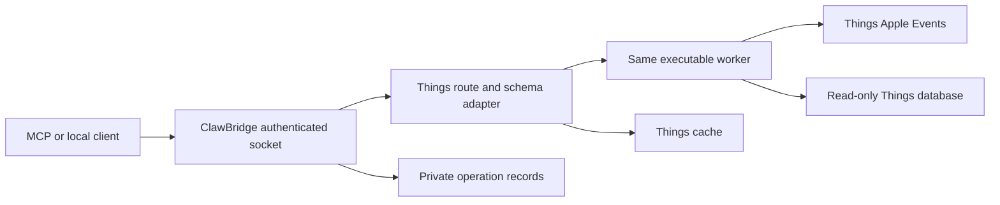
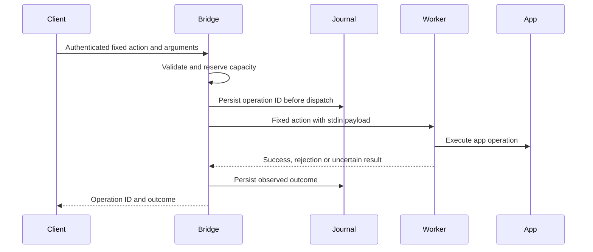
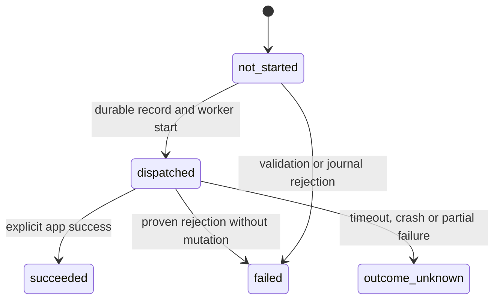
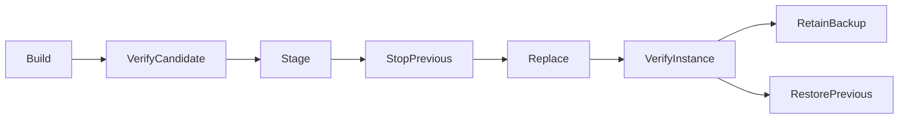
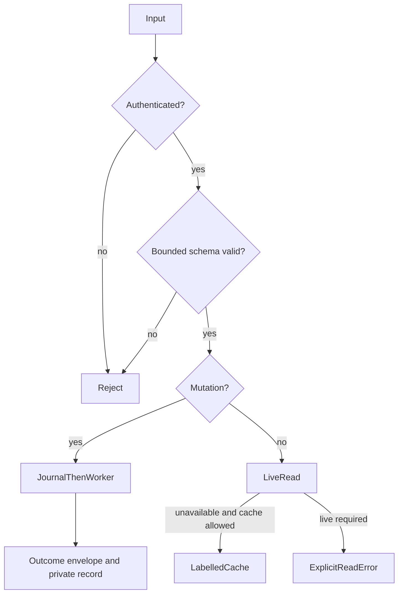

# Things3-MCP 2.5 and ClawBridge Reference - Plan

## Goal Capsule

Objective: Developers can adapt a documented, verifiable bridge to let authorised clients use their Mac apps while the user is away.

Means: An integrated Things3-MCP 2.5 implementation and a reproducible ClawBridge starter extraction (KTD1, KTD7).

Authority: The Product Contract governs behaviour; technical decisions govern implementation within it. Ross authorises implementation, review and pull-request preparation through LFG. Release publication, merging, replacement of his installed bridge and new privacy grants remain separate actions.

Execution profile: One Things3-MCP pull request includes the integrated implementation and extraction tooling. A ClawBridge repository receives the generated standalone source after its isolated checks pass. The coordinator owns integration, evidence and shipping. Stop dependent work only for an unresolved authority boundary or a material feasibility blocker; continue independent work.

## Product Contract

### Summary

Things3-MCP 2.5 includes a signed local bridge with app-specific permissions and recoverable operation records. ClawBridge demonstrates the same mechanisms with a synthetic adapter. Developers receive build, signing, installation and adaptation instructions with evidence limits stated explicitly.

### Problem Frame

Clients need stable access through a logged-in Mac session without transferring operating-system grants to each client. Other developers need to understand which permissions their app needs, how signing preserves identity, and how to diagnose unsuccessful or uncertain operations.

### Requirements

#### App access and authority

- R1. Preserve the established Things MCP tools and Things bridge routes, with additive diagnostics and explicit migration notes for changed fallback policy.
- R2. Use Things Automation for fixed scripting operations without requiring System Events, Accessibility, Screen Recording or Input Monitoring.
- R3. Separate the Things database read capability from scripting capability, and document the minimum verified grant for each supported configuration.
- R4. Each adapted bridge has a fixed target, fixed action schemas and its own signed identity; callers cannot supply scripts, executables, imports or arbitrary filesystem paths.
- R5. The built-in transport stays on an owner-only Unix socket with bearer authentication, with no implied isolation between processes running as the same user.
- R6. Document the distinction between application path validation and operating-system confinement, including the limits of Full Disk Access and security-scoped file selection.

#### Outcomes and recovery

- R7. Never automatically retry a mutation after it may have reached the app, including through a different provider.
- R8. Give each dispatched mutation a durable operation ID and distinguish known success, rejection before dispatch, and uncertain outcomes.
- R9. Offer owner-only, bounded recovery records with full validated payload capture explicitly opt-in; ordinary logs must exclude task content and credentials.
- R10. Expose read freshness, capability observations and operation lookup to both MCP and direct bridge clients without changing established data shapes silently.

#### Distribution and verification

- R11. Provide repeatable locked build instructions and separate local-signing and Developer ID distribution profiles, with provenance for each artifact.
- R12. Verify candidate signatures before installation, preserve the previous installation for rollback, and identify the candidate instance during readiness checks.
- R13. Supply a standalone ClawBridge reference with a synthetic adapter and a reproducible link to the integrated source.
- R14. Default automated tests must never use a personal Things library or modify operating-system permissions.
- R15. Record locked-session, permission and identity checks separately from unit, packaging and signature checks; unperformed live checks remain explicit release gates.

### Actors and flows

- A1. A Mac owner builds, signs and installs a bridge, grants only the permissions its adapter needs, and can revoke them.
- A2. An authorised client reads data or requests a fixed mutation through the local endpoint, including through an existing authenticated remote execution channel.
- A3. An adapter developer exports ClawBridge, replaces the synthetic adapter, declares app-specific capabilities and verifies the resulting bundle.
- F1. Build and verify the artifact; install with rollback; perform interactive app-specific consent; test the exact installed artifact while logged in and locked (R11, R12, R15).
- F2. Authenticate and validate a request; persist its operation record; dispatch once; report or look up the outcome (R5, R7-R10).
- F3. Diagnose missing app, unobserved/denied permissions, unavailable database or cached data without granting permissions or mutating app records (R2, R3, R10).

### Scope boundaries

FastMCP 3, a public HTTP service, OAuth, per-bot credentials, arbitrary plugins, automatic recovery replay and database writes are outside this change. AFK means an awake Mac with the user logged in after interactive setup; it excludes sleep, logout and FileVault preboot.

#### Deferred to Follow-Up Work

Public binary release and notarisation submission require the appropriate signing credentials and explicit release authority. Full supported-API parity for the SQLite read backend and a production sandboxed Things variant require separate capability and live permission evidence. The reference must explain these options without presenting them as verified properties.

## Planning Contract

### Key technical decisions

- KTD1. Extract a small dependency-free `clawbridge` package for local transport, secure runtime files, worker execution and operation records; keep Things routes, schema, cache and app access in `things3_mcp_bridge` (R4, R13).
- KTD2. Replace process enumeration with the event-free AppleScript `application id ... is running` property. Do not use `name` as a permission probe; actual app commands retain their own error handling (R2).
- KTD3. Use a fixed dispatch registry and bounded JSON input. Worker payloads travel on stdin, and worker stderr is captured rather than copied into ordinary logs (R4, R5, R9).
- KTD4. Operation IDs correlate attempts; they are not idempotency keys. Persist accepted records before dispatch, mark interrupted dispatched records uncertain on restart, and expose recent records plus lookup. A caller correlation label helps find a lost response but never authorises or deduplicates requests (R7-R10).
- KTD5. Store journal metadata by default and opt-in validated payloads for seven days, at most 1,000 records and 10 MiB. Retention never deletes an active record; exhaustion rejects new writes before dispatch. Journal failure before dispatch rejects; failure after dispatch preserves known success where available and otherwise reports uncertainty (R8, R9).
- KTD6. The default automatic write provider uses the bridge only. Explicit `direct` mode remains available for legacy installations. Align the client deadline above the worker deadline, preserve uncertainty on lost responses, and reject arbitrary HTTP bridge URLs (R1, R5, R7).
- KTD7. Generate standalone ClawBridge source from an explicit export allowlist, with source revision and file hashes. Things3-MCP remains the source of truth during this reference phase; no manually maintained second copy of transport code (R13).
- KTD8. Build a native frozen onedir executable from locked inputs. Parameterise adapter identity in a validated build configuration, sign nested code inside out, and keep local self-signing separate from hardened Developer ID signing (R11).
- KTD9. Preserve the per-user LaunchAgent arrangement with associated bundle identifiers. Stage and verify installation, stop the old service, replace, verify exact candidate readiness, and restore the previous app and job if startup fails (R12).
- KTD10. Document app-specific permission profiles. Compiled path restrictions and read-only SQLite are application controls; only an enabled OS sandbox supplies OS confinement. Security-scoped bookmarks do not automatically override protected app-container access (R3, R6).

### High-Level Technical Design

These sketches describe boundaries and observable behaviour; implementation may use simpler equivalent structures.

Component relationships:

Mutation protocol:

Operation states:

Installation lifecycle:

Request decisions and data flow:

Capability and mode combinations:

| Mode | Read authority | Write authority | Fallback |
| --- | --- | --- | --- |
| auto | Bridge, then labelled cache | Bridge | Optional direct reads only |
| bridge | Adapter's available read capabilities | Things Automation | Labelled cache unless live required |
| direct | Host process's existing grants | Host's Things Automation | None |
| synthetic ClawBridge | Synthetic fixture only | Synthetic fixture only | None; no Mac privacy grant |

### Assumptions and considered alternatives

The user wants an integrated 2.5 release candidate and a developer reference, not a release-triggering GitHub Release today. The project keeps its current MCP major. Existing endpoint envelopes remain compatible where possible; additive protocol fields are optional for old servers, and unknown write outcomes are conservative when an old server omits them.

Full idempotent replay was considered but omitted: the target app cannot atomically commit an operation with the journal. A plugin host, new privileged daemon, per-client identity service and automatic permission management add authority without serving this reference. A production App Sandbox variant is not asserted until its child-process, socket and data-access paths have been tested.

### Source grounding

The current request path is `fast_server.py` -> provider facade -> Unix HTTP server -> same-executable worker -> Things. Read fallback is separate from mutation dispatch. The bridge currently has useful read provenance in its envelope; the client can preserve it without replacing public task structures. The implementation starts from commit `7481ab0` in the signed-bridge work, with its existing app adapters and packaging scripts.

- [AppleScript application properties](https://developer.apple.com/library/archive/documentation/AppleScript/Conceptual/AppleScriptLangGuide/reference/ASLR_classes.html) supports KTD2.
- [Apple file-system permission layers](https://developer.apple.com/forums/thread/678819) and [sandbox file access](https://developer.apple.com/documentation/security/accessing-files-from-the-macos-app-sandbox) inform KTD9 and KTD10.
- [Things AppleScript support](https://culturedcode.com/things/support/articles/4562654/) and [third-party AI guidance](https://culturedcode.com/things/support/articles/5510170/) bound R3.
- [Apple distribution signing](https://developer.apple.com/documentation/xcode/creating-distribution-signed-code-for-the-mac/) and [PyInstaller macOS notes](https://www.pyinstaller.org/en/stable/feature-notes.html) inform KTD8.

## Implementation Units

### U1. Establish hermetic verification

Goal: Make normal test execution safe for a developer's Mac. Requirements: R14. Files: `tests/conftest.py`, `pytest.ini`, `tests/README.md`, CI test configuration. Approach: require explicit live opt-in, protect every live cleanup fixture, and prohibit real AppleScript/database calls in default tests. Execute this before the broad suite. Test scenarios: default collection skips live suites; accidental real app access fails before execution; mocked provider tests still run. Verification: targeted safety tests followed by the existing mocked provider module.

### U2. Extract and harden the local core

Goal: Provide the reusable fixed-action execution boundary. Requirements: R4, R5, R7-R9, R13; KTD1, KTD3-KTD5. Files: new `src/clawbridge/`, `src/things3_mcp_bridge/server.py`, protocol integration and focused tests. Approach: secure runtime paths, bound body sizes/time/concurrency, validate worker envelopes, use stdin, and record mutation outcomes. Test scenarios: wrong token, symlinks, concurrent startup, malformed/oversized bodies, saturation, lost worker response, interrupted journal, exhausted retention, payload opt-in and ordinary-log canaries. Verification: synthetic socket and worker integration tests without Things.

### U3. Improve Things capabilities and client outcomes

Goal: Preserve app functionality while making permission and freshness observations usable. Requirements: R1-R3, R7, R10; KTD2, KTD6. Files: `applescript_bridge.py`, provider modules, `fast_server.py`, `db_reader.py`, `auth_status.py`, adapter schemas and focused tests. Approach: remove System Events and unrelated filesystem probes, classify actual operation errors, expose read-only status and operation lookup, retain provenance in formatted MCP output. Test scenarios: app absent, Automation denied, database denied with scripting available, partial mutation, old envelope, cached reads, live-required rejection and zero direct retry after dispatch. Verification: mocked adapter/provider/MCP tests.

### U4. Make packaging and installation repeatable

Goal: Let another developer build, sign and install with attributable inputs and recovery. Requirements: R11, R12; KTD8, KTD9. Files: build/sign/install/uninstall scripts, `packaging/macos/`, packaging helper module and tests. Approach: derive bundle version from package, render plists safely, retain install backup, check candidate instance, and provide explicit signing profiles. Test scenarios: unusual HOME paths, tampered signature, missing signing identity, interrupted copy, startup failure, old listener, rollback and uninstall preserving private state. Verification: stubbed lifecycle tests, shellcheck and isolated synthetic frozen-bundle smoke.

### U5. Document and export the reference

Goal: Deliver an adaptable standalone source tree with clear permission choices. Requirements: R3, R6, R9, R11, R13, R15; KTD7, KTD10. Files: README, security/build/adaptation guides, synthetic adapter, export script, export manifest tests and `.env.example`. Approach: document app-specific permission profiles, journal controls, migration and separate signing paths; export only public source and synthetic fixtures. Test scenarios: export has no Things dependency, private data or machine paths; manifest hashes match; standalone install and smoke run from an empty directory. Verification: build and run the exported project independently.

### U6. Integrate the 2.5 candidate and review

Goal: Produce reviewable, checked changes and explicit release evidence. Requirements: R1-R15. Dependencies: U1-U5. Files: package/version metadata, lock, CI and session documentation. Approach: reconcile interfaces, update version consistently, run checks, inspect packaged assets, perform independent security/correctness review, and prepare pull requests. Test scenarios: source distribution contains locked build inputs; wheel imports both packages; synthetic signed artifact runs; diagnostics identify its exact version. Verification: Verification Contract and Definition of Done.

## Verification Contract

Run all automated commands in the isolated checkout. First make U1's default test behaviour hermetic; do not run the historical full suite against a personal Things library.

- `uv sync --locked --group dev`
- `uv run --locked pytest` for default hermetic coverage, including transport and frozen-worker fixtures.
- `uv run --locked ruff check .` and `uv run --locked ruff format --check .`
- `uv run --locked mypy src`
- `uv run --locked bandit -r src` using the repository's intended exclusions.
- `shellcheck scripts/*.sh`
- `uv build` and artifact-content/import checks for wheel and sdist.
- Build the synthetic macOS adapter, verify signatures with `codesign --verify --deep --strict`, then run its health/read/write smoke with an isolated runtime directory.
- Export ClawBridge and run its own tests/build from the exported tree with no import access to Things3-MCP.

Adapt commands to the actual project configuration without weakening checks to obtain a pass. Use only synthetic fixtures for mutations. Preserve exact source revision, build inputs and artifact hashes in evidence. Local signature verification does not establish notarisation or live TCC behaviour.

Release acceptance separately records exact installed artifact, declared permissions, unlocked/locked reads and synthetic creates/updates, restart and same-identity upgrade. Existing live bridge restoration is not proof for the new candidate. Do not replace the installed app, alter privacy settings or lock the user's Mac as a build/test side effect.

## Definition of Done

U1-U6 have passing relevant automated checks, independent review findings are resolved or explicitly bounded, and the integrated and exported source trees build. Documentation teaches reproducible signing and per-app permissions without claiming unperformed evidence. Private recovery payloads and credentials never enter public artifacts. Commits and pull requests describe improvements and capabilities neutrally, without disparaging previous work or naming a model. Abandoned experiments are removed from the production diff. Pull requests are attached to the chat; merge and release remain unperformed. Any remaining live acceptance gate has a concrete procedure and is clearly marked unverified.
