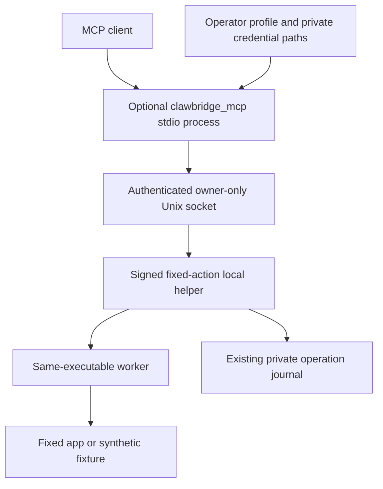
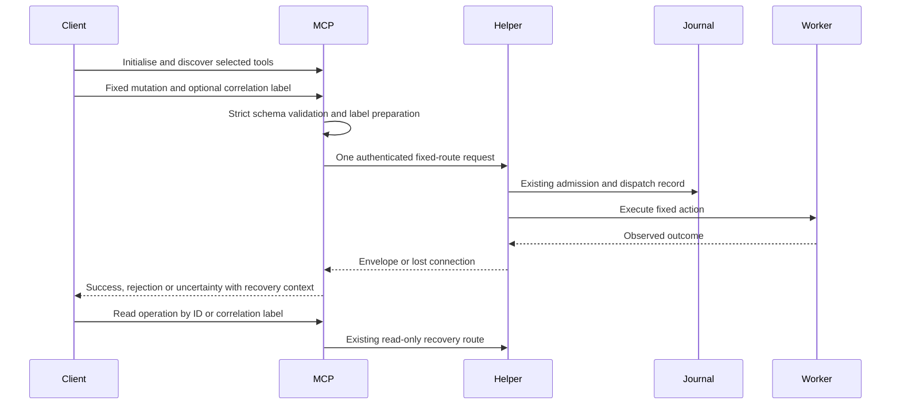

# ClawBridge MCP Routing Addendum - Plan

## Goal Capsule

Objective: Developers can connect an MCP client to each ClawBridge example and use its fixed actions through a signed local helper without writing the missing integration themselves.

Means: A small optional MCP interface with fixed example profiles, plus protocol and frozen-counter verification (KTD1-KTD5).

Authority: This addendum implements Ross's correction that routing MCP tools to protected local binaries is the main use case. It extends the existing approved work in `docs/plans/2026-11-04-1438-feat-bridge-reference-plan.md` and `docs/plans/2026-11-04-clawbridge-examples-addendum.md`. It supersedes the earlier exclusion of standalone MCP wrappers. All other established requirements and completed work remain in force.

Execution profile: Three units extend the existing Things3-MCP source pull request and refresh the existing private ClawBridge pull request. The coordinator owns shared manifests, locks, export, final verification and delivery. Implementation, review, commits, pushes and pull-request preparation are authorised. Merging, release publication, live installation, privacy grants and real Music or Things actions require separate authority and are excluded here. Stop dependent work for an invalidated authority boundary or material feasibility blocker; continue independent work.

---

## Product Contract

### Summary

ClawBridge supplies runnable MCP stdio tools for its synthetic counter, Music scripting and read-only catalogue examples. The MCP process forwards only fixed actions to the authenticated Unix socket of the separately running local helper. The guides make this the primary integration path and retain direct socket calls as diagnostics.

### Problem Frame

The current standalone examples stop at local HTTP routes. Developers who want MCP access must still design and implement the main integration themselves, although the Things application already demonstrates the complete path. The reference therefore omits the interface its intended users need first.

### Key Decisions

- **MCP is the primary reference interface.** Governs R1, R2, R9. (session-settled: user-directed — chosen over a standalone socket reference requiring developers to add their own MCP wrappers: routing MCP tools to protected local binaries is the main use case.)

### Requirements

**Fixed tools and operation results**

- R1. Each example supplies a runnable stdio MCP server that supports initialise, tool discovery and calls to its existing domain actions.
- R2. The operator selects one fixed profile, socket and token-file location at process launch; tools accept only the domain arguments and recovery fields defined below.
- R3. Tool results retain the bridge envelope's domain data, error code, authorisation hint, source/freshness and applicable operation ID, correlation ID, outcome and journal warning; bridge failures are MCP error results.
- R4. A mutation is sent at most once. Lost or malformed responses after possible dispatch produce an uncertain outcome with its pre-dispatch correlation label; known success remains success when accompanied by a journal warning.
- R5. Agents can inspect authenticated bridge status and existing operation records through bounded read-only tools; initialise and tool discovery remain passive when the helper is stopped.

**Distribution and proof**

- R6. The execution core and standalone signed-binary build remain free of MCP runtime dependencies; the optional MCP interface uses the repository's existing SDK major.
- R7. The explicit export includes the interface, its tests, optional dependency, locked inputs and documentation without introducing a Things dependency or overwriting the independently maintained private README.
- R8. Automated proof exercises real MCP initialise/list/call against an authenticated Unix service and the frozen synthetic counter; Music OS control is mocked and catalogue data is synthetic.
- R9. Source guides, generated REFERENCE and the private README present complete MCP setup, fixed tool examples, permissions and SSH stdio routing with accurate evidence limits.

### Acceptance Examples

- AE1. Covers R1-R4, R8. Given a synthetic helper and the counter profile, an MCP client discovers the counter tools, increments once and receives identifiers that match the helper's retained operation record.
- AE2. Covers R2, R8. A call with an unknown field, a Boolean counter amount or a string in place of an integer fails before a socket request; no script, target, executable, HTTP route or file-path tool parameter exists.
- AE3. Covers R3-R5. After a mutation loses its response, MCP reports uncertainty and its correlation label. Listing operations with that label can locate the attempt; no tool automatically retries it.
- AE4. Covers R1, R5. With no running helper or token file, an MCP client can initialise and list the chosen profile's tools. A call returns a sanitised unavailable error and creates no runtime state.
- AE5. Covers R1, R8. Music state/play/pause select the fixed adapter actions with the OS-control boundary mocked. Catalogue items/search read the fixture through the real read-only adapter and leave database bytes unchanged.

### Scope Boundaries

The existing Things MCP tools and BridgeThingsProvider remain the integrated Things example. This addendum adds the missing standalone interface and preserves prior transport, signing, app permissions, retention and test-safety contracts.

Considered and not built: a generic command, route or plugin framework, because the examples have fixed small action sets; a network MCP listener and per-bot authentication, because operator-launched stdio and the existing same-user socket meet this scope; and automatic service startup or permission tools, because lifecycle and consent stay with the operator. A separately authenticated remote service or dynamic adapter requirement would require a new design.

#### Deferred to Follow-Up Work

Real Music control, protected application-data access, consent attribution, installed-candidate identity, consent retention and logged-in locked-session behaviour remain separate live acceptance work. Synthetic protocol and signature proof do not establish those properties. Public release and notarisation submission remain outside the authorised delivery.

---

## Planning Contract

### Key Technical Decisions

- KTD1. **Keep MCP in a sibling package.** Add `src/clawbridge_mcp` without imports from `clawbridge` initialisers. Existing PyInstaller configurations collect all `clawbridge` submodules, so placing SDK imports inside that package could pull them into the signed binary. The sibling package implements R6 without changing the proven execution build graph.
- KTD2. **Use the existing SDK 1.11.0 with strict raw arguments.** Use its lower-level Server stdio surface and the existing Action schemas before forwarding. This avoids FastMCP coercion and ignored extra fields while retaining the current SDK major. The standalone optional `mcp` extra pins the version already in the root lock; ordinary base dependencies remain empty. This is a bounded application of the existing SDK, with no surviving mechanism choice that needs a bake-off (R1, R2, R6).
- KTD3. **Register only the selected profile's tools.** Use the fixed tool table below and explicit dispatch, with a small internal stdlib Unix HTTP client. Required startup arguments are `--profile` with `counter`, `music` or `catalogue`, `--socket` and `--token-file`. Do not import or execute app adapters merely to list tools. This realises R1, R2 and R5. (session-settled: user-directed — chosen over an extraction that leaves MCP wrappers to developers: the reference must demonstrate the complete MCP-to-local-binary path.)
- KTD4. **Read existing credentials and validate envelopes.** Reuse private-file checks from `clawbridge.runtime`; never call token creation helpers. Use a 35-second client deadline above the current 30-second worker deadline, bounded response reads and no redirects or retries. Decode structured error bodies even for non-2xx responses, and require confirmed mutation success. Mark a proven pre-send failure `not_started`; preserve bridge outcomes; classify post-send transport/protocol loss conservatively per R4. Reuse `BridgeThingsProvider` behaviour, without importing its Things/httpx dependency into the standalone client.
- KTD5. **Keep recovery context visible.** Mutation tools accept an optional validated `correlation_id`; create one before sending when omitted and return it in transport errors. Use the existing 1-128 character correlation-label grammar. Recovery tools call existing status/list/lookup routes, encode path/query values and retain their current bounds and payload-capture behaviour (R3-R5).
- KTD6. **Separate client proof from the binary build environment.** Linux checks install the MCP extra and must run the protocol tests, while a separate base/build environment verifies SDK absence. The macOS smoke runs the optional MCP client against the same signed synthetic helper used by the existing smoke. No Music/catalogue helper is launched by default tests (R6-R8).

### Fixed Tool Contract

| Profile | MCP tool | Existing bridge action | Ordinary arguments | Kind |
| --- | --- | --- | --- | --- |
| counter | `counter_read` | GET `/demo/read` | none | read |
| counter | `counter_echo` | POST `/demo/echo` | `text` string | read |
| counter | `counter_increment` | POST `/demo/increment` | `amount` integer; optional correlation ID | mutation |
| music | `music_state` | GET `/music/state` | none | read |
| music | `music_play` | POST `/music/play` | optional correlation ID | mutation |
| music | `music_pause` | POST `/music/pause` | optional correlation ID | mutation |
| catalogue | `catalogue_items` | GET `/catalogue/items` | none | read |
| catalogue | `catalogue_search` | POST `/catalogue/search` | non-empty `query` string | read |
| all | `bridge_status` | GET `/status` | none | read |
| all | `get_operation` | GET `/operations/<id>` | `operation_id` | read |
| all | `list_operations` | GET `/operations` | optional correlation ID; integer `limit` 1-100, default 25 | read |

The wire fields use `correlation_id` consistently. Reuse the existing action limits, exact types and unknown-field rejection rather than adding a looser parallel schema. Tool annotations follow the Kind column, including read-only POST catalogue search. Standard error results expose a sanitised envelope in text and structured content supported by the pinned SDK; stdout carries MCP protocol messages only. Do not turn domain data or private request content into logs.

### High-Level Technical Design

Component ownership and data flow:

Protocol sequence and recovery:

Profile/permission modes are defined by the Fixed Tool Contract. This addendum introduces no new helper lifecycle or operation-state machine.

### Assumptions

The three examples are separately configured MCP server instances, rather than one instance exposing all app profiles. CLI startup arguments suffice; no new environment variables or credential format are needed. SSH carries stdio to a process running on the Mac, and its socket/token remain on that Mac. It does not add per-bot authorisation.

The exact module-internal helper names and MCP result assembly depend on the pinned SDK during implementation; they do not change the tool or envelope contract. Source grounding starts at `fec6c2efbc23dd9e8a5838eb71f1880fe54654b8`.

### Source Grounding

`src/clawbridge/actions.py`, `runtime.py`, `server.py`, `worker.py` and `journal.py` own the validated transport/execution/recovery rules. `src/things3_mcp/providers/bridge.py` provides the existing client outcome pattern. The adapter routes are in `src/clawbridge/demo.py` and `src/clawbridge/examples/{music,catalogue}.py`. Existing real-socket fixtures, account-home fixture redirection and default process guards are in `tests/test_clawbridge_transport.py`, `tests/test_clawbridge_examples.py`, `tests/conftest.py` and `reference/clawbridge/tests/conftest.py`.

The [official SDK README at v1.11.0](https://github.com/modelcontextprotocol/python-sdk/blob/v1.11.0/README.md) anchors SDK usage to the root lock, rather than current tutorials for SDK 2. The installed SDK's client session, stdio and in-memory helpers provide actual protocol test seams; direct Python function calls alone are insufficient.

---

## Implementation Units

### U1. Deliver the fixed MCP interface

**Goal:** An MCP client can discover and use each fixed profile with truthful results and recovery context.

**Requirements:** R1-R5, R8; AE1-AE5; KTD1-KTD5.

**Dependencies:** Existing bridge/adapters at the grounded source revision.

**Files and ownership:** Interface implementer owns new `src/clawbridge_mcp/__init__.py`, `src/clawbridge_mcp/server.py` and `tests/test_clawbridge_mcp.py`. The client stays internal to this small package. Shared manifests remain U2-owned.

**Approach:** Implement the selected-profile registration, input validation, authenticated socket client and MCP result mapping against the fixed contracts. Reuse runtime safety checks and Action validation without importing app execution modules for discovery. Follow existing client outcome handling and synthetic Unix-server fixtures.

**Execution note:** Start with a real MCP initialise/list/call test that exposes the missing interface. Preserve both default safety harnesses; use in-process adapter workers for Music/catalogue protocol proof and mock only Music's OS-control call. Redirect catalogue account-home lookup, because changing HOME alone does not isolate that adapter.

**Test scenarios:**

- Covers AE1. Counter initialise/list/call returns the exact six-tool profile, correct read/mutation annotations, one increment and a matching retained operation.
- Covers AE2. For every profile, unknown fields and cross-profile tool names fail. Boolean/string counter amounts, empty catalogue queries, NUL/oversized strings, malformed operation labels and out-of-range list limits cause no socket request.
- Covers AE4. Missing service/token allows passive discovery, while calls return a sanitised error and create no token, journal or process.
- Wrong token, unsafe private token path, malformed/oversized response and structured HTTP errors retain useful static failure context without leaking credentials or submitted text.
- Covers AE3. Simulated loss after mutation send retains the supplied or generated label, reports uncertainty and produces at most one dispatch. A connection failure proven before send reports not_started.
- Completion persistence failure preserves known success and its journal warning; adapter rejection and unknown operation lookup become MCP errors with envelope fields intact.
- Covers AE5. Music uses only its fixed scripts under a mocked OS call. Catalogue items/search use temporary SQLite fixtures, honour bounds and leave source bytes unchanged.

**Test seam:** `tests/test_clawbridge_mcp.py` proves MCP registration and calls through a real authenticated Unix service; mocked Music execution does not prove OS consent or a frozen Music worker.

**Verification:** Exact tool/schema and result assertions pass through a genuine SDK client session, with no direct-action substitute for the protocol coverage and no weakening of existing test guards.

### U2. Package, export and prove the complete path

**Goal:** The interface installs and runs from both source and an independent export while the signed helper retains its dependency boundary.

**Requirements:** R6-R8; AE1; KTD1, KTD2, KTD6.

**Dependencies:** U1's package and tool contract.

**Files and ownership:** Coordinator owns `pyproject.toml`, `uv.lock`, `reference/clawbridge/pyproject.toml`, `reference/clawbridge/uv.lock`, `scripts/export_clawbridge.py`, `scripts/smoke_example_bridge.py`, `.github/workflows/lint.yml`, `reference/clawbridge/.github/workflows/check.yml`, `tests/test_clawbridge_export.py` and `tests/test_clawbridge_packaging.py`. Add `tests/test_clawbridge_mcp_stdio.py`, also explicitly exported. This unit creates the package/CLI/dependency entries once.

**Approach:** Include the sibling package in both wheels, add the `clawbridge-mcp` entry point, lock the standalone optional `mcp` extra and export the interface/tests explicitly. Replace the export test's blanket ban on MCP lock entries with assertions for empty base dependencies, allowed optional SDK, no Things dependency and isolated base/build imports. Extend the existing synthetic-only smoke with an optional MCP check against its already-running helper; retain signature, exact PID/executable/build, direct-transport and canary checks. Install the client extra outside the isolated binary-build environment for CI proof.

**Test scenarios:**

- A fresh standalone export installs with the extra and runs all protocol tests, including stdio initialise/list/call with stdout containing only JSON-RPC.
- A separate base/build environment imports the stdlib core without the SDK installed, and the frozen collection excludes the sibling MCP package and SDK.
- Export hashes match every included source file; the private README, unknown files, Things modules and personal data remain excluded.
- Covers AE1. The optional frozen smoke discovers counter tools, reads/echoes/increments and finds the resulting operation in the same verified signed helper. The counter increment is additional to the existing smoke, so assertions use the observed baseline rather than assuming zero.
- Stdio startup/call failures emit no token or submitted text in diagnostics; missing optional SDK produces an actionable installation error outside protocol stdout.

**Test seam:** The stdio test covers real process framing and package entry points. Frozen smoke covers the signed counter executable and worker; it does not establish live Music, protected data or installed-service behaviour.

**Verification:** Existing source/export checks and updated Python 3.12/3.13 CI pass. Fresh standalone build/sign/frozen-MCP evidence identifies its source revision, artifact and exact process. Normal and sandboxed synthetic smoke remain valid.

### U3. Centre the guides and refresh standalone delivery

**Goal:** A developer can follow the reference's primary MCP path and understand which process owns app permissions.

**Requirements:** R9 and documentation aspects of R2-R8; KTD3, KTD5, KTD6.

**Dependencies:** U1 tool names and U2 install/smoke commands.

**Files and ownership:** Documentation implementer owns `README.md`, `reference/clawbridge/REFERENCE.md`, `docs/examples/README.md`, `docs/examples/music.md`, `docs/examples/catalogue.md`, `docs/adapting-clawbridge.md` and necessary MCP-specific deltas in `docs/bridge-build.md` and `docs/security/local-bridge-security.md`. Coordinator owns the active source session record and private standalone README/session record. Private paths are relative to the separately identified ClawBridge checkout during delivery.

**Approach:** Lead with the complete MCP-to-signed-helper diagram and synthetic quick start. Give a concrete client command/args configuration for each profile using absolute operator-controlled socket/token paths, a discover/call/result example and an SSH stdio configuration. Keep credential values off the command line, explain private recovery payloads and preserve app-specific grant/signing limitations. Replace the claim that developers must supply wrappers only after U1-U2 exist. Regenerate allowlisted standalone files from the source of truth, preserve the private README and unrelated content, then align that README with the implemented interface.

**Test scenarios:**

- Execute the documented synthetic MCP setup from a fresh export and verify the named tools and result shape.
- Review each Music/catalogue example against actual tools and fixed arguments without launching a real app or reading personal data.
- Verify the independently maintained README no longer says MCP wrappers are missing, source/export provenance remains accurate and links resolve in each repository.

**Test seam:** Documentation smoke uses the synthetic helper only; SSH syntax review does not claim a remote session was exercised.

**Verification:** Independent code and document reviews find no unresolved contract defect. Both pull-request descriptions report current-head checks and separate live acceptance limits. Session and daily activity records are updated by the coordinator.

---

## Verification Contract

Use locked uv environments and retain the existing hermetic guards before broad checks. The following are existing project checks with MCP coverage added where appropriate; adapt dependency selection without silently skipping the new tests.

| Scope | Check | Required evidence |
| --- | --- | --- |
| Source | `uv run --locked pytest` | Existing hermetic suite plus MCP protocol and stdio tests; live suites remain skipped |
| Source/export | Ruff lint and format checks, mypy and configured Bandit | All modified Python/configuration covered with current exclusions retained |
| Export with MCP extra | Locked dev sync with `--extra mcp`, then pytest and static checks | Protocol tests actually execute on Python 3.12 and 3.13 |
| Base/build export | Locked build-only environment and package-content inspection | No installed/imported MCP dependency in the helper build; sibling package excluded from frozen graph |
| Packages | `uv build` and wheel/source archive inspection | Both declared Python packages, entry point, guides and locked build inputs present |
| macOS synthetic | Existing build/sign smoke with MCP client enabled | Strict signature, exact process/build, authenticated socket, frozen worker and operation lookup linked |
| Workflow/shell edits | actionlint, shellcheck for affected shell, syntax and whitespace checks | Changed CI/shell definitions validate |

Repeat the independently exported synthetic runtime proof after final source changes. Keep source revision and clean/dirty provenance with build/sign/smoke artifacts. Run normal and sandboxed synthetic checks without installing the candidate or granting permissions. Re-run relevant checks after review corrections and obtain current-head hosted CI before reporting delivery complete.

---

## Definition of Done

The three profiles have usable fixed MCP tools with protocol-tested schema, outcome and recovery parity. The source and independently exported projects pass their relevant automated checks, and the signed synthetic helper is exercised through MCP. Optional SDK installation does not enter the permission-bearing binary's build graph. The guides and private README describe the implemented primary path. Independent review findings are resolved or explicitly bounded, abandoned implementation attempts are removed and all pre-existing work is preserved. Existing pull requests receive the checked changes; neither is merged or released. Deferred live permission and locked-session checks remain stated as unverified.
